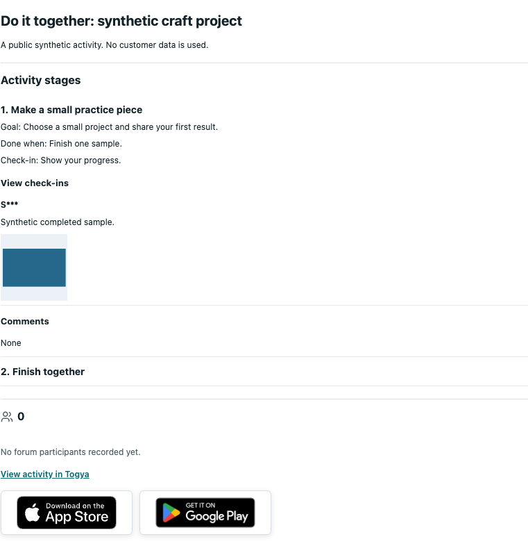
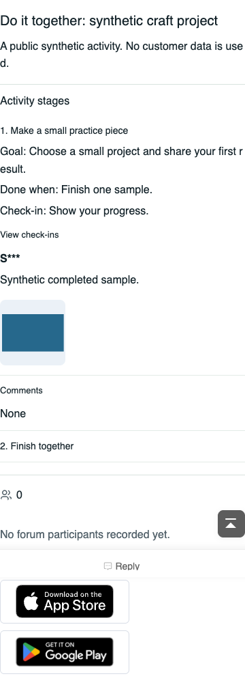

# Synthetic UI Previews / 合成界面预览

These captures show the unreleased development candidate inside an isolated official DX X5 fixture. Every activity, participant label and progress image is synthetic. No customer forum, member account, private instructions, credential or production screenshot is included. Discuz core is installed separately, not distributed with the plugin.

以下为隔离官方 DX X5 环境中的开发候选截图，活动、参与者显示名和打卡图片均为合成示例，不包含客户站点或真实会员资料。截图不是 RC、正式发行或完整流程验收证明。

## PC

Cached public stages and a locally decoded progress image. Only the first public stage's instructions are visible; locked instructions are not rendered.

本地缓存展示公开阶段和打卡图片；锁定阶段不展示私有说明。

## Touch

Native Touch page at a 390-pixel viewport with mobile user-agent/touch emulation. This is virtual browser evidence, not a physical iPhone or a real app-camera test.

390 像素宽度的原生 Touch 页面，采用移动浏览器模拟；不等同于真机、真实相机扫码或会员发帖验收。

See [STATUS.md](STATUS.md) for the passed, failed and unrun boundaries. The current downloadable Alpha remains separate from this source preview.
